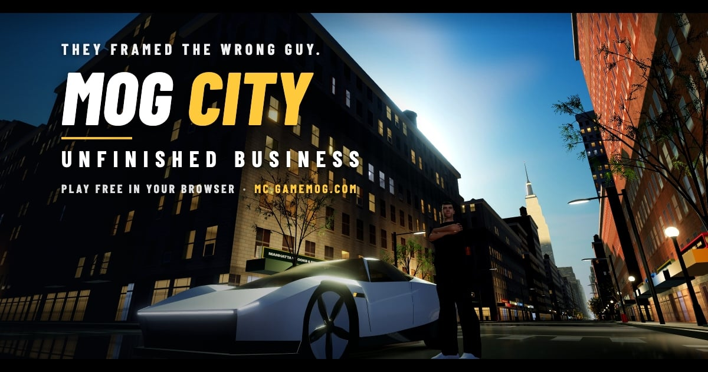

# MOG CITY: Unfinished Business

[](https://mc.gamemog.com)

**▶ [Play now at mc.gamemog.com](https://mc.gamemog.com)** (free, in your browser, desktop or phone) · [Contribute](CONTRIBUTING.md) · [Roadmap](ROADMAP.md)

**MOG CITY: Unfinished Business** is GameMog's flagship open-world mission game, in the browser. Dan, a first-year associate at JPBank, has just been fired and charged with insider trading: the bank set him up to take the fall. Its security team, a gang of thugs in suits, has taken the laptop that could prove it, and the bank's CEO, Mr. Big, wants a signed confession. With Jane, his girlfriend since college, piecing the evidence together, Dan has missions to run and a name to clear.

Drive Dan's rocket-boosted supercar through Manhattan, fight the Suits hand to hand, follow the trail from Chelsea to the West Side yards to Washington Square, and prove he was set up.

Mog City is free to play, and its code is open source: it lives in [GameMog/GameMog](https://github.com/GameMog/GameMog) on the `mogcity` branch. It is built on [Slop New York](https://github.com/mrdoob/slop-newyork) by Mr.doob (three.js, WebGPURenderer and TSL).

## Play it

Play it at **[mc.gamemog.com](https://mc.gamemog.com)**. To run it yourself there is no build step: get the `mogcity` branch, serve the folder and open it in a browser (a recent Chrome or Edge works best; phones work too):

```bash
git clone --branch mogcity https://github.com/GameMog/GameMog.git mog-city
cd mog-city
python3 -m http.server 8000
```

Then open http://localhost:8000. Click, or press any key, for sound.

## What's in it

- **Three story missions.** *Bagged*: the opening, then Chelsea Park. *Burner*: Bryant Park, Times Square and the West Side yard. *KOLs*: Gears' garage and Fiona's Blimpco rally at Washington Square.
- **An 81-second opening cutscene**, with phone calls, cut scenes and a cast of voiced characters.
- **Street fighting.** Fists, kicks, bats, bottles and trash cans; counters, dodges and takedowns. No guns.
- **Dan's car.** A supercar with a V8 or an all-electric mode (Q), cold-gas thrusters for hops and sideways dashes, and a boost.
- **A living Manhattan.** Traffic, crowds, crashes, police calls, chases you can lose, and a car radio with four stations.
- **Controller support** for Xbox, PlayStation and other standard pads, plus keyboard and mouse.

## Controls

| | Keyboard and mouse | Controller (Xbox) |
|---|---|---|
| Move · look | WASD · mouse | Left stick · right stick |
| Sprint · jump | Shift · Space | LT (hold) or L3 · A |
| Get in / out of the car | F | Y |
| Drive · brake / reverse · steer | W · S · A / D | RT · LT · left stick |
| Boost · hop · dash left / right | Shift · Space · Z / C | X · A · LB / RB |
| Electric / engine | Q | D-pad up |
| Reset car to road | X | B |
| Strike · heavy · counter · dodge · grab | J or left click · K or right click · Q or L · C · E | X · Y · LB · B · RB |
| Radio: next station · off / on | R · T | D-pad right · D-pad down |
| Map · brief · pause | M · B · Esc | View · R3 · Start |
| Skip a cutscene | Hold Space | Hold A |

The pause menu has every control, mission select, checkpoints, sound settings and the credits.

## Credits and licences

The code is under the MIT License (see [LICENSE](LICENSE)), the same licence as Slop New York, which this game is built on.

Some parts are not ours and keep their own terms:

- The street-combat system, the Suits' rig and the freeflow fight moves are ported from **Spiderbench** by Shikhar and used with the author's permission. They are not covered by the MIT License.
- Some motion capture (`assets/anim/bandai`: the Suits' walks and idles, the rally crowd, Dan's fight footwork) is from the **Bandai Namco Research Motion Dataset**, © 2022 Bandai Namco Research Inc., under CC BY-NC 4.0: non-commercial use only and not covered by the MIT License (see [NOTICE](NOTICE)).
- The rest of the music, the engine recordings, the 3D characters' source assets, the motion capture and the props come from their own authors under CC0, CC BY and similar licences.
- Dan's, Jane's and the side characters' voices are synthesised with Qwen3-TTS (Apache-2.0).

[NOTICE](NOTICE) and [assets/CREDITS.md](assets/CREDITS.md) list every one of them, and the game shows them on its Credits page.

Geographic data: NYC Open Data and © [OpenStreetMap contributors](https://www.openstreetmap.org/copyright) (ODbL).

## For contributors

Start with [CONTRIBUTING.md](CONTRIBUTING.md): how to run it, the house rules, licences and how pull requests are reviewed. What could come next is in [ROADMAP.md](ROADMAP.md); ideas and bugs go to the [issues](https://github.com/GameMog/GameMog/issues) (say it is about Mog City).

- `index.html` loads the city (`js/`, from Slop New York) and the game (`wagmi/`: missions, combat, the car, audio, radio, characters).
- `docs/STORY.md` is the story and the cast (their looks and voices); `docs/MISSIONS.md` is the same story plus how a mission is built; `docs/VOICE-LINES.md` is the line sheet and how voices are made.
- `tests/` holds the city's tests (`node --test tests/`).
- All names, companies and events in Mog City are fictional (JPBank and Blimpco included); nobody in the game is based on a real person.
