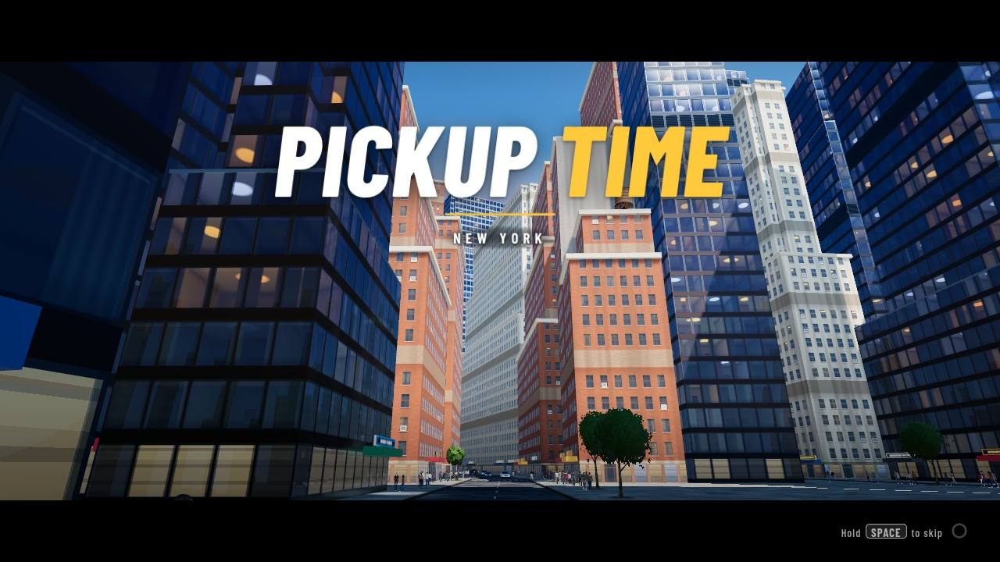
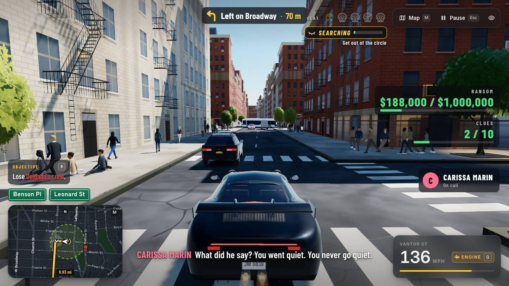
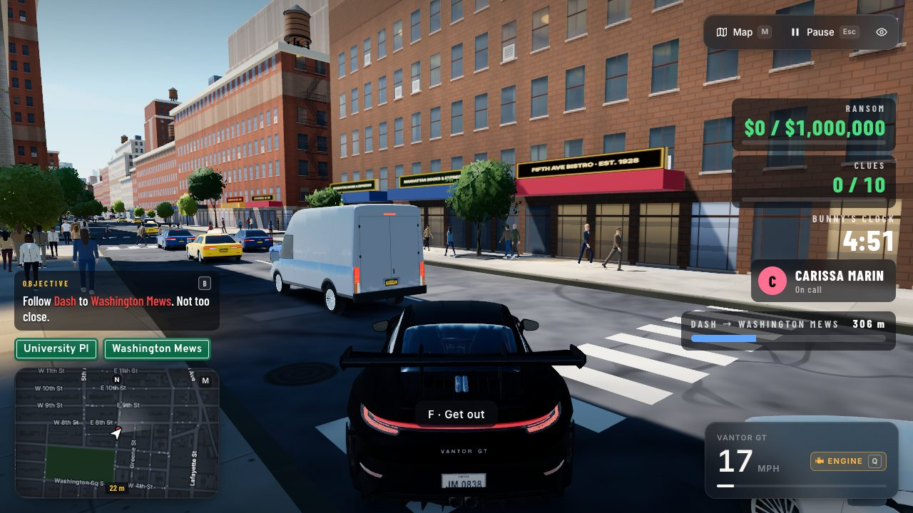
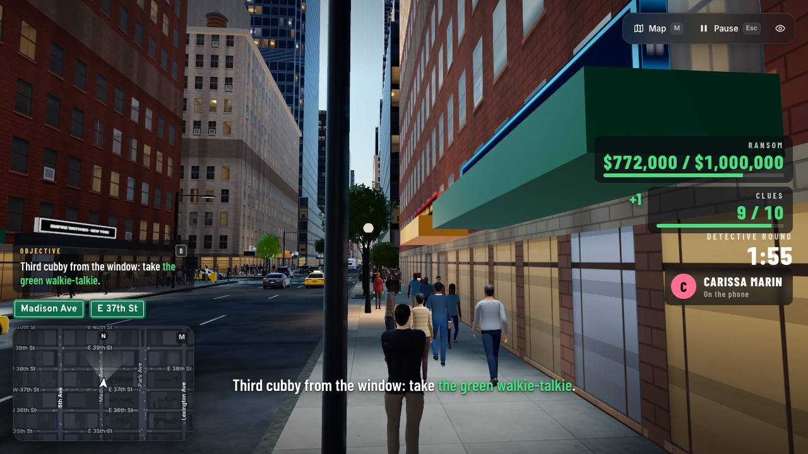
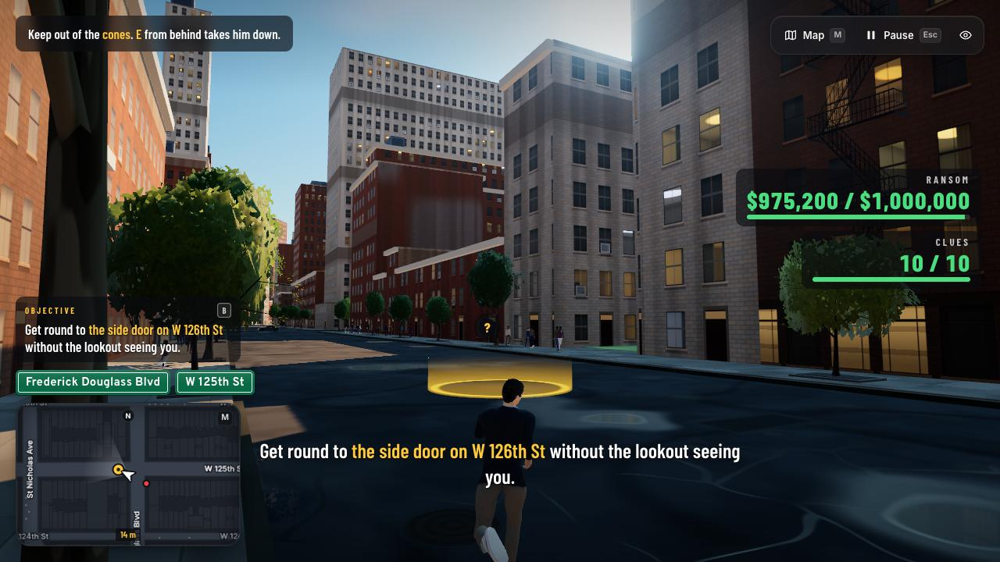
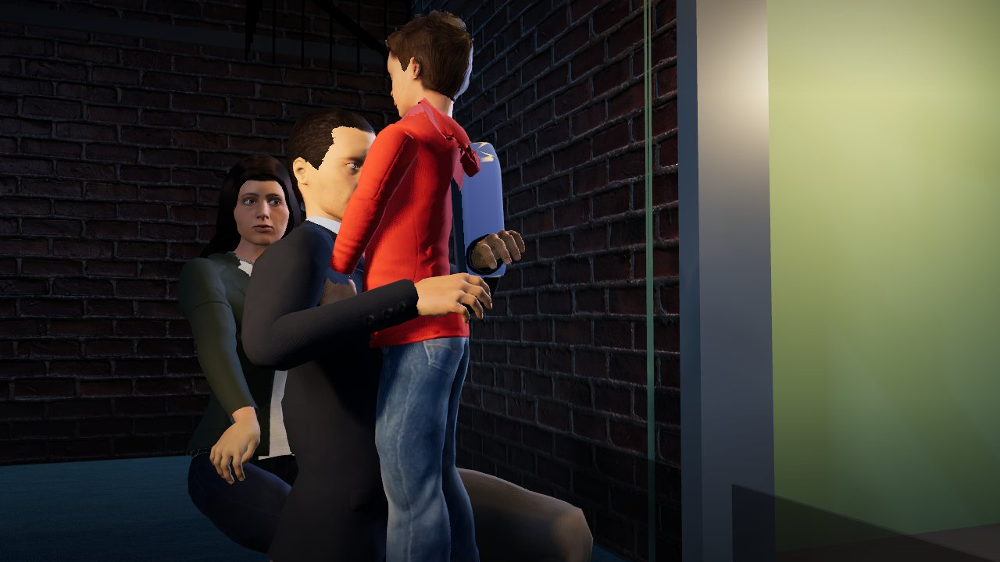
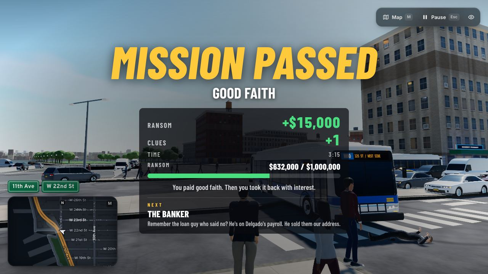
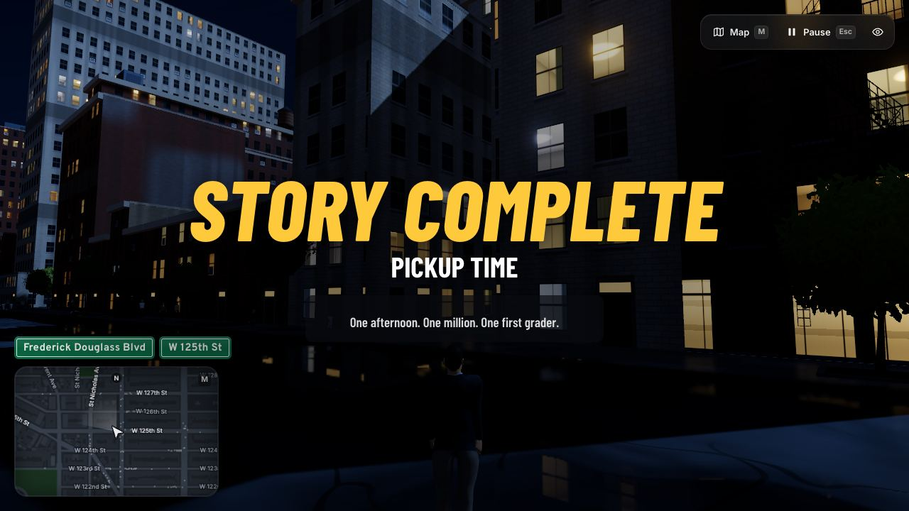

# Story Kit: architecture

How a story world gets from a JSON pack to a game playing on gamemog.com. This is the map. The pack format, the builder
and the forge are in [`storykit/README.md`](../storykit/README.md). How Mog City plays each step is in
[`storykit/BUILDER.md`](../storykit/BUILDER.md). The runtime's own reference is in Mog City's repo (the `mogcity` branch:
`tools/storyrun/README.md`).

Two codebases are involved:

- **GameMog** (`main`, gamemog.com) gates packs, stores worlds, publishes games, and frames the player.
- **Mog City** (`mogcity` branch, mc.gamemog.com) is the engine that plays every story world: the city, the HUD, the
  cars, the cast and the story runner (`wagmi/storyrun/`).

GameMog has no story engine of its own.



## 1. The flow, end to end

```
storykit/packs/<id>.json         story pack v2 (data only: no code, no coordinates)
        │  gatePack()            storykit/pack/gate.ts + schema.json: refused, or passed (with warnings and clamps)
        ▼
Story Kit store                  lib/storykit-store.ts, on the Render disk (data/storykit/)
  draft  ──PUT files──►  files   GLBs (glb/<cast id>), voice clips (voice/<clip>.ogg), art (art/key-wide.jpg ...)
    │                            every file once, by SHA-256: data/storykit/blobs/<h0h1>/<sha256>.<ext>
    │  seal                      the runner world (toRunnerPack + the files' addresses + the voice plan) frozen as
    │                            /storykit/f/<sha256>.json
    ▼
  kept                           published with a game: never swept (drafts not kept are swept after 24 h idle)
        │
        ▼
games row (gamemog.db)           format 'world', code `GameMog.world({ storykit: <pack> });`,
                                 meta { mode: 'storykit', storykit: { city, pack: <store draft id>, world: <sha256>, ... } }
        │
        ▼
/g/<slug>/play                   app/g/[slug]/play/route.ts + play-frame.tsx frame Mog City:
  https://mc.gamemog.com/?pack=https://gamemog.com/storykit/f/<sha256>.json&host=https://gamemog.com&game=<game id>
        │
        ▼
Mog City (wagmi/storyrun)        fetches the world (allow.js: content-addressed, SHA-256 checked against its name),
                                 plays it, and posts { source: 'gamemog', type, ... } to ?host= only (host.js)
```

### The pack

A pack is `storykit/packs/<id>.json` (`"storykit": 2`). It names places (`"@les"`, from `storykit/pack/cities.ts`),
people (cast ids), rides and steps. It never contains coordinates or code. The gate (`gatePack(pack, opts)`) checks
the schema, the extra rules at the top of `gate.ts` (rules 1 to 15), the words, the vehicle and brand rules, and the
verbs each ride can do. `toRunnerPack(pack)` turns a passed pack into what Mog City reads (`"storykit": 1`).

### The store

`lib/storykit-store.ts` keeps its own SQLite file (`data/storykit/store.db`: drafts, files, blobs) beside the blobs.

- **Opening a draft:** `POST /api/storykit/drafts`. This gates the pack and returns the draft id and a write token,
  once. Only the token's SHA-256 is stored.
- **Files:** `PUT /api/storykit/drafts/<id>/files/<kind>/<name>` adds a file. Each kind has its own limits (§4).
- **Reading:**
  - `GET .../pack` returns the draft's live runner world (no-store). Mog City reads it during a test drive.
  - `GET .../source` returns the gated source pack. It needs the token.
- **Sealing:** `POST .../seal` freezes the world as `/storykit/f/<sha256>.json`.
- **Publishing:** `POST /api/games` marks the store draft as kept and names the sealed world in the game's meta.
- **Abandoning:** `DELETE` the draft, or leave it untouched for `STORYKIT_DRAFT_TTL_H` hours (24 by default) and the
  sweep removes it, then every blob nothing points at.
- **Serving:** `/storykit/f/<sha256>.<ext>` (`app/storykit/f/[file]/route.ts`) serves the same bytes forever, cached
  as immutable, with CORS for Mog City's origin only.

A Mog points at its parent's blobs for every person and line it keeps, so those cost no disk.

### The game row and the play page

`lib/storykit-publish.ts` connects a store draft to a game:

- `storeDraftOf(meta)` and `sealedWorldOf(meta)` read the meta.
- `storyFrameSrc(world, game, site)` builds Mog City's address.
- `storySite()` is `https://gamemog.com` in production, and the dev server's own origin locally.
- Locally, `STORYKIT_MC_ORIGIN` (localhost only) points the frame at a Mog City dev server.

The play frame (`app/g/[slug]/play-frame.tsx`) listens only to Mog City's origin.

A play is counted once per session, when the first `result` message arrives with `passed: true`. That message must
name this game and this exact sealed world (`story` = its SHA-256).

### The messages Mog City posts (`wagmi/storyrun/host.js`)

| type | data | when |
|---|---|---|
| `ready` | `{ gameId, hash, story: { v: 2, ok, id, hash, why } }` | the world is loaded (or refused, `ok: false`) |
| `mission-start` | `{ id, title }` | a mission starts |
| `progress` | `{ mission, step, kind, i, n }` | each step as it starts |
| `mission-fail` | `{ id, why, step, kind }` | a mission fails (also a test-drive timeout, `timeout: true`) |
| `mission-end` | `{ id, how, secs \| why }` | a mission ends |
| `result` | `{ game, mission, passed: true, story, secs }` | a mission passed, once per mission per session (needs `?game=`) |
| `story-end` | `{ id }` | the last mission passed |
| `keyart` | `{ wide, square }` (transferred ArrayBuffers) | under `?keyart=1`: a staged hero shot of the first drive |
| `hidden` | `{ hidden }` | the tab went behind or came back |
| `error` | `{ kind: 'page' \| 'rejection' \| 'load', message, where? }` | each distinct page error once, 40 at most |

Each message is `{ source: 'gamemog', type, ...data }`, posted only to `?host=` when that origin is allowed
(`allow.js hostOf`). Mog City reads no inbound messages in story mode.

For a creator's world, the work page (`public/storykit/work.js`) uses the same messages for the test drive. It
forges, voices, test-drives, captures the key art and headshots, and reports with
`POST /api/storykit/drafts/<id>/report` (see `storykit/README.md`).

## 2. The STORYKIT switch

One server environment variable, read in `lib/storykit-switch.ts`:

| value | effect |
|---|---|
| unset (or anything else) | off. The site is exactly as it is without the Story Kit: every Story Kit door returns 404 or refuses, and a story build is refused before anything is spent. |
| `owner` | on only for the owner's /admin session (the same cookie). A story world the owner publishes goes in hidden. Mog City still reads `/storykit/f/<sha256>.*` and `/api/storykit/drafts/<uuid>/pack` without the cookie, because nobody can guess those names. |
| `on` | on for everyone. Public story worlds (Pickup Time included) play only with this value. |

`/create` is prerendered, so changing the switch needs a rebuild (on Render: "Save, rebuild, and deploy"). The store
is capped by `STORYKIT_DISK_MB` (400 by default). The rules are in `docs/RULES.md`, section 1h.

## 3. First-party worlds: the showcase exemption and shipping by migration

Creators' worlds come from the builder and go through the store's routes. GameMog's own worlds ship from the repo,
and a migration in `deploy/migrate.mjs` writes them into the store at boot.

### The two first-party story worlds

| world | pack | gated as | migration | what it is |
|---|---|---|---|---|
| Mog City's own story | `storykit/packs/mog-city.json` | `{ own: true }` (the one world whose title may name Mog City) | `2026-11-05-mog-city-own-story` (`deploy/migrations/mog-city-story.json`; `scripts/storykit-own-world.ts` on a dev database) | a hidden world with no public page: the parent that Mogs of `/g/mog-city` remix (`lib/storykit-mogcity.ts`). No files of its own. |
| **Pickup Time** | `storykit/packs/pickup-time.json` | `{ showcase: true }` | `2026-11-07-pickup-time` (`deploy/migrations/pickup-time-story.json`, `pickup-time/world.json`, `pickup-time/voice/*.ogg`, `pickup-time-{cover,wide,icon,sky}.jpg`) | public at `/g/pickup-time`: 15 missions in 3 acts, 9 hand-built bodies, 910 voice clips |

### The showcase exemption (gate rule 15)

`storykit/pack/schema.mjs` defines both lists:

- `SHOWCASE_PACKS = ['pickup-time']`, the worlds the exemption covers.
- `SHOWCASE`, their larger limits: 640,000 bytes, 5 acts of up to 8 missions, 120 steps a mission, 2,400 lines,
  24 cast, a 30 to 150 s opening, 48 places.

A Create gets `LIMITS`: 160,000 bytes, 3 acts, 9 missions, 60 steps, 12 cast, 600 lines.

`gatePack(pack, { showcase: true })` applies the larger limits. Only the repo's own scripts pass that option. The
store, the builder and Mogs never do. The gate refuses it with a parent, and it refuses any id that is not listed.
Everything else is gated the same way: places, verbs, words and voices.

The showcase steps (`passenger`, `comfort`, `convoy`, `ally`, `roadblock`, `stealth`, `car`) play in any world, but a
Create may not write them yet (`BUILDER.md`, "What a Create does not write yet").

### How the Pickup Time migration works

`scripts/storykit-showcase.ts --export` writes two things:

- **The record**, `deploy/migrations/pickup-time-story.json`. It holds the gated pack, the game's fixed id and meta,
  and every file with its SHA-256 and size:
  - the 9 GLBs from `public/storykit/cast/hand/`;
  - the clips in `deploy/migrations/pickup-time/voice/<line hash>-<voice key>.ogg`.
- **The sealed world**, `deploy/migrations/pickup-time/world.json`. Every line heard down a phone (a caller's line, a
  voicemail or a voice note, never the hero's own) is marked `fx: 'phone'`, so Mog City plays it through its phone band.

At boot, the migration does the following:

1. It waits (the migration is not recorded, so the next boot tries again) while `STORYKIT` is off or the store has no
   room.
2. It re-hashes every file and refuses everything if one byte differs.
3. It writes the blobs and a store draft in the `kept` state.
4. It inserts the game: public, with its cover, key art and `art_avatar` headshot.

It runs once. If a showcase with `packId` `pickup-time` already exists, or another game holds the slug or the id, it
changes nothing.

`npm run check` keeps the record current. `scripts/storykit-pack-check.ts` calls `showcaseProblems()`, which fails when
any of these is true:

- the record or the world is not what the repo makes now;
- a clip is on disk that no line plays;
- an image is missing;
- the world is larger than 640,000 bytes.

### Regenerating the pack

The pack is generated from the sources in [`storykit/showcase/pickup-time/`](../storykit/showcase/pickup-time/README.md):
`gen_top.py`, `gen_act1.py`, `gen_act2.mjs`, `gen_act3.mjs`, and `merge.mjs` (which also attaches `casting.json`).
`storykit/packs/pickup-time.json` is the committed output. Running the generators and the merge reproduces it byte for
byte (checked on 7 Nov).

### Shipping an update to Pickup Time

1. Edit the generators (or the pack), then run the merge. It gates the pack as a showcase and writes
   `storykit/packs/pickup-time.json`.
2. Rebuild the built pack: `npm run storykit:pack -- pickup-time --no-forge`. The hand-built bodies are not forged.
3. Voice any new or changed lines. A clip is named `<line hash>-<voice key>`, so unchanged lines keep their files.
   Put every clip the voice plan needs into one folder, with a `manifest.json` of `{ "clips": { "<clip>": { "secs" } } }`,
   then run:
   `node --import ./scripts/ts-resolve.mjs scripts/storykit-showcase.ts --export --voice <folder>`.
   Without `--voice`, the export keeps the record's clips and lengths, and it fails when a line has no clip.
4. Run the checks (§6). `npm run check` then fails for any clip that no line plays: delete it from
   `deploy/migrations/pickup-time/voice/`.
5. **Write a new migration with a new id** (for example `2026-11-XX-pickup-time-v2`). `2026-11-07-pickup-time` is
   already recorded in production and never runs again, and it leaves an existing showcase alone in any case. The new
   migration should do the following:
   - write the new blobs and a new kept store draft the same way;
   - point the game's `meta.storykit.world` (and `pack`) at the new ones, matched by `packId` `pickup-time` and the
     showcase flag;
   - keep the old world, so the change can be reversed.
6. **Do not use the owner's patch route** (`POST /api/storykit/admin/patch`, `StoryStore.patch`) for Pickup Time. It
   refuses this world for two reasons:
   - it gates the draft's pack without the showcase exemption, which rejects 15 missions;
   - it requires `world.voice.lines` to equal `voicePlanOf(pack)` exactly, and Pickup Time's phone-band lines carry
     `fx: 'phone'`.

   The patch route is for creators' worlds (a new opening, a reforged body).

## 4. Store limits, and the open issue with Mogs of Pickup Time

`lib/storykit-store.ts` `LIMITS`:

| what | limit |
|---|---|
| source pack | 160,000 bytes (the gate's own limit) |
| GLB | 3 MB each, 16 MB per world |
| voice | 1 MB each, 600 clips, 8 MB per world |
| art | 512 KB each, 16 files, 3 MB |
| a world's distinct blobs (inherited ones included) | 24 MB |
| disk | `STORYKIT_DISK_MB` (400 MB). At 90%, no new draft opens and the build route refuses a story build. |
| drafts | 60 open at once, 200 opened per day, swept after `STORYKIT_DRAFT_TTL_H` (24 h) |

Pickup Time does not fit these limits, because it was written to a showcase's: a pack of 152 KB with 15 missions,
979 spoken lines, 910 clips (about 13 MB) and 9 bodies (about 21 MB).

The migration writes it directly into the store, so the limits never apply to it.

**Open issue: a Mog of Pickup Time cannot be built yet.** A Mog is gated without the exemption and stored as a normal
draft. The parent's pack already breaks the mission and line limits (15 missions against 9, 979 lines against 600),
and the parent's files break the voice count and the GLB and world totals. A Mog of `/g/pickup-time` would therefore be
refused, and nothing in the build route makes an exception for it yet. It needs a decision, either:

- Mogs of a showcase inherit the showcase limits (and the store counts inherited blobs only once), or
- a Mog of a showcase is refused up front with a clear message.

## 5. Headshots and Jump In

Every game ships a headshot of its main character on a light-blue sky. The homepage's Jump In bubbles show it as
`/g/<slug>/avatar`, from `games.art_avatar`. The headshot standard is in `docs/RULES.md` §2c:

- the lens is straight on;
- the eyes sit 40% down the frame;
- the face is centred;
- a 512 px JPEG square.

For story worlds:

- **Creators' worlds:** the work page (`public/storykit/work.js`) shoots the hero straight on against the sky's flat
  key colour (`lib/portrait-sky.ts` `SKY_KEY`) and stores it as `art/avatar.jpg`. When the report arrives,
  `lib/storykit-publish.ts` lays that image onto the sky's gradient (`lib/portrait-sky-key.ts` `onSky`, server only)
  and saves it as `art_avatar`. The cast cards' `head-<cast id>.jpg` headshots are on a dark studio ground, so they are
  not used for this.
- **First-party worlds:** the migration carries the headshot as a file, for example
  `deploy/migrations/pickup-time-sky.jpg` (John Marin), written to `art_avatar`.

A new first-party world must ship one. A world without one falls back to a square cut from its cover, which the owner
does not accept for new worlds.

## 6. Checks

Run these before every commit (both must pass, even for a docs-only change):

```
npx tsc --noEmit -p .
npm run check
```

`npm run check` includes the Story Kit checks:

- the pack gate and every pack's fixtures;
- the cast registry and the anchors;
- the store;
- the owner-only switch at every door;
- the patch route;
- the browser forge's parity;
- the showcase record.

Run these when the change touches them:

| command | when |
|---|---|
| `npm run storykit:pack -- <id>` | after editing any pack (`check` fails while a built pack is stale) |
| `npm run storykit:builder-check` | the builder, the build route or `BUILDER.md` (runs against a stand-in model on 127.0.0.1, no paid call) |
| `npm run storykit:mogcity-check` | the Mog City framing, the store's world format, the play page |
| `npm run check:platform` | publishing, Mogs, dares, admin, test drive (real Chrome against the local dev server) |

On the Mog City side, run `node --test tests/storyrun*.test.mjs`, plus the headless tools in `tools/storyrun/` (see
that README).

## 7. What Pickup Time looks like

| | |
|---|---|
|  |  |
| A pursuit (HEAT, SEARCHING) with Carissa on the car phone and the RANSOM and CLUES meters | `tail`: the distance meter to the target, a named timer, the Vantor GT |
|  |  |
| A sneak on foot under a named timer (DETECTIVE ROUND) | `stealth`: get round a lookout unseen ('?' over his head, the cone on the ground) |
|  |  |
| A cutscene staged in a set (`wagmi/storyrun/sets.js`, the `bank-office` room) | The finale's reunion, staged in the `alley` set |
|  |  |
| The MISSION PASSED card: the money gained, the bar toward $1,000,000, the next mission | The end card after Mission 15 on W 125th St |
